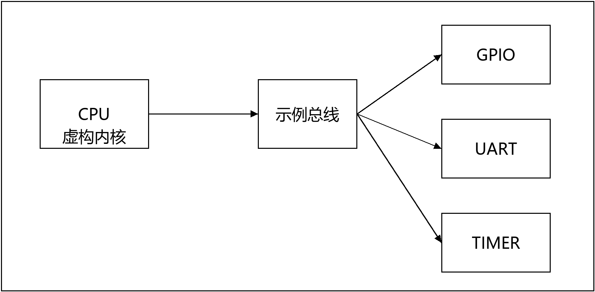

# MCU UM Builder

从寄存器数据和功能说明生成 MCU 用户手册，包含技术插图、寄存器位图、统一表格、题注和目录。

公开示例全部使用虚构的 DemoMCU，覆盖 GPIO、UART 和 Timer，不包含真实芯片规格或公司内部资料。

## 查看结果

- [Word 示例手册](assets/demo/generated/DemoMCU_UM.docx)
- [系统框图 PNG](assets/demo/generated/figures/architecture.png) / [可编辑 SVG](assets/demo/generated/figures/architecture.svg)
- [验证记录](assets/demo/generated/validation.json)
- [完整 skill 压缩包](mcu-um-builder.zip)



## 使用

需要 Python 3.10+ 和可用的中文字体。安装依赖后运行：

```sh
python -m pip install -r requirements.txt
python scripts/build_um.py --model assets/demo/model.json --content assets/demo/content.json --out output/demo
python scripts/audit_docx.py output/demo/DemoMCU_UM.docx --report output/demo/audit.json
python -m unittest discover -s scripts -p "test_*.py"
```

输出目录必须不存在。Windows 默认使用微软雅黑或宋体，Linux 默认检查 Noto CJK；其他环境请调整 `scripts/figure_tools.py` 的字体路径。

在 Word 中更新全部域、目录和图表目录，并逐页检查后再正式交付。仓库中的示例已使用 Word 刷新目录并检查7页；结构检查工具本身不会更新目录或验证分页。

## 作为 skill 安装

将此仓库内容放入个人 skills 目录下的 `mcu-um-builder` 文件夹，使 SKILL.md 位于该文件夹根目录。入口说明见 [SKILL.md](SKILL.md)。

## 输入与能力边界

输入为扁平寄存器 JSON 和独立功能说明 JSON。可接收 [keil-pack-builder](https://github.com/xiatianxiatianyaya/keil-pack-builder) 的 model.json；任意 Excel 表格需要先明确映射并转换。详细结构见 [输入模型](references/input-model.md)。

默认采用紧凑的技术手册版式：分级标题、灰色表头、居中表格、图片黑框、页眉横线和页码/总页数。它是通用排版配置，不包含任何公司的文档模板。`style.profile` 可设为 `custom` 使用自定义参数。

现成脚本支持新建手册、框线图和寄存器位图。不提供任意现有 Word 的无损更新器，也不自动验证真实芯片功能、复杂时序或封装映射。未知寄存器语义应补充来源，不能根据字段名称猜写。

## 定制适配

可讨论 Excel 输入适配、客户授权模板排版和文档检查流程。通过 [Issues](https://github.com/xiatianxiatianyaya/mcu-um-builder/issues) 提交非保密需求；请勿公开上传客户寄存器表、内部手册或其他未授权材料。交付范围、费用和验收另行约定。

## 许可证

[MIT](LICENSE)。第三方工具和用户输入资料按各自许可证或授权处理。
